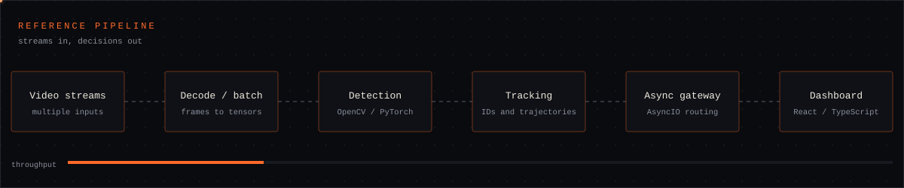

  

  
  

<pre>
Studying       Second-year AI/ML
Building       Multi-stream vision engines, async inference gateways, civic monitoring tools
Main focus     Computer vision, edge AI, distributed inference, MLOps
Also           Full-stack platforms and resilient microservices
Main languages Python, TypeScript
</pre>

<h3 align="center">Languages</h3>

  
  
  
  

<h3 align="center">Machine Learning</h3>

  
  
  
  

<h3 align="center">Frontend</h3>

  
  
  

<h3 align="center">Backend and Data</h3>

  
  
  

<h3 align="center">Environment and Tools</h3>

  
  
  
  

<h3 align="center">Projects</h3>

| Project | Problem | Stack |
| :--- | :--- | :--- |
| [**TriNetra / TriNetra2.0**](https://github.com/Parv3/TriNetra) | Tracking objects across multiple camera streams in real time | TypeScript, OpenCV |
| [**NagarDrishti**](https://github.com/Parv3/NagarDrishti) | Turning city-level signals into a monitoring dashboard | TypeScript, React |
| [**SynapseGateway**](https://github.com/Parv3/SynapseGateway) | Handling many concurrent inference requests without blocking | Python, AsyncIO |
| [**gesturecontrol**](https://github.com/Parv3/gesturecontrol) | Controlling a computer through hand gestures from a webcam | Python, OpenCV, MediaPipe |

<h3 align="center">Commit history, playable</h3>

  <picture>
    <source media="(prefers-color-scheme: dark)" srcset="https://raw.githubusercontent.com/Parv3/Parv3/output/pacman-contribution-graph-dark.svg">
    <source media="(prefers-color-scheme: light)" srcset="https://raw.githubusercontent.com/Parv3/Parv3/output/pacman-contribution-graph.svg">
    
  </picture>

<h3 align="center">Activity</h3>

  
  
  

<h3 align="center">Connect</h3>

  
  
  

