 

I'm a second-year AI/ML student. Most of what I build sits between a model and the thing that has to run it: vision pipelines that process several video streams, gateways that route inference requests, and the web layer that makes the output usable.

## Currently working on

| Project | What it does |
| :--- | :--- |
| [TriNetra](https://github.com/Parv3/TriNetra) | Multi-stream vision engine with spatial tracking |
| [NagarDrishti](https://github.com/Parv3/NagarDrishti) | Civic monitoring platform built around AI-driven telemetry |
| [SynapseGateway](https://github.com/Parv3/SynapseGateway) | Asynchronous gateway for routing requests to AI services |

## Projects

| Project | Problem | Stack |
| :--- | :--- | :--- |
| **TriNetra / TriNetra2.0** | Tracking objects across multiple camera streams in real time | TypeScript, OpenCV |
| **NagarDrishti** | Turning city-level signals into a monitoring dashboard | TypeScript, React |
| **SynapseGateway** | Handling many concurrent inference requests without blocking | Python, AsyncIO |
| **gesturecontrol** | Controlling a computer through hand gestures from a webcam | Python, OpenCV, MediaPipe |

## Tools

| Area | Used |
| :--- | :--- |
| Machine learning | PyTorch, TensorFlow, OpenCV, MediaPipe |
| Backend | Python, Node.js, AsyncIO, PostgreSQL, SQLite |
| Frontend | TypeScript, JavaScript, React, Next.js, Tailwind CSS |
| Environment | Linux, Bash, Git, Docker |

## Activity

  
  
  
  

## Contact

[GitHub](https://github.com/Parv3) &nbsp;/&nbsp; [LinkedIn](https://linkedin.com) &nbsp;/&nbsp; [Email](mailto:contact@parv3.dev)
